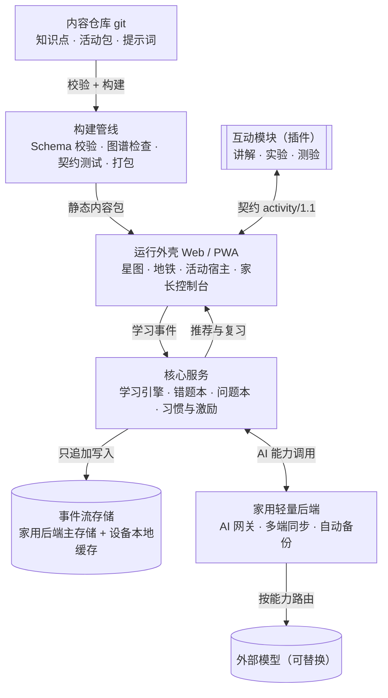
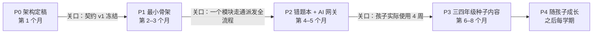

# 好奇号 Curio · 总体架构设计

2026-11-05 · Luka

> **P0/P1 的执行计划以 GitHub issue #13（路线图总览）为准；长期架构决定见 `docs/adr/`，领域模型见 `docs/domain.md`。本文下面的「路线图与里程碑」一节已被它们取代，保留作历史记录。**
>
> 本文由设计文档导出，此后以仓库里的这份为准。数据格式以 `schemas/` 为准：本文里的 YAML 样例是早期草案，`domain` 字段已改为 `theme`（课标大概念），并新增了 `unit`（教材单元）。

## 愿景与设计原则

平台定名「好奇号」：孩子是舰长，知识点是待登陆的星球，知识图谱就是星图，界面里不出现「学习」二字。它以「知识图谱 + 可插拔互动模块」为骨架、内容与代码分离的长期平台，目标是稳定服务约 10 年（2026 年三年级 → 2036 年高三）。

三个育人目标不停留在口号，而是落成平台机制：

| 目标 | 平台机制 |
| --- | --- |
| 好奇心 | 每个知识点以一个「驱动问题」开场；孩子随时可把疑问记进「问题本」，问题本本身也是学习内容 |
| 思考力 | 实验统一走「预测 → 观察 → 解释」；讲解用提示阶梯，先引导、后给答案 |
| 好习惯 | 每次学习结束写一句反思；温和的间隔复习提醒；不做排名，也不做惩罚式连续打卡 |

六条设计原则：

1. **内容即数据**：知识点、讲解、实验、测验都是带版本、可校验的数据文件。前端框架十年里会换代，内容不用动。
2. **图谱是骨架，学科只是标签**：知识点之间用「前置 / 相关」边连接，可跨学科、跨年级。小学「科学」到初中拆成物理、化学、生物，只改标签，不重建结构。
3. **模块用契约隔离**：每个互动模块是独立的沙箱包，只通过固定接口与平台通信。任何模型都能按契约开发，某个模块写坏了也不会拖垮平台。
4. **同一知识点，按年龄分「镜头」**：一个节点可挂多个年龄段的讲法，从具象到抽象。孩子长大后回看，看到的是更深一层。
5. **学习记录是事件流**：只追加、不改写；掌握度和复习计划都从事件流计算，算法可随时替换。
6. **离线可用、低运维**：各设备本地缓存，断网也能继续学；一个放在家里的轻量后端负责 AI 网关、多端同步和自动备份。部件尽量少，你不写代码也能部署和验收。

## 决策记录

前 4 条来自你的需求，已确认；其余是我作为架构师先定的默认值，追问过程中逐条确认或推翻。

| # | 决策 | 状态 | 依据 |
| --- | --- | --- | --- |
| D1 | 学科：数学、物理、化学、生物；暂不含语文、英语 | 已确认 | 你的需求 |
| D2 | 覆盖小学三年级到高三，约 10 年 | 已确认 | 你的需求 |
| D3 | 先汇总各年级知识点成图谱，再逐点开发讲解、实验、测验 | 已确认 | 你的需求 |
| D4 | Claude 负责总体架构、底层设施和全部子模块提示词；子模块可派给其他模型实现 | 已确认 | 你的需求 |
| D5 | 以国家课程标准为主轴，教材版本作为映射层 | 已确认 | 教材会改版，课标更稳定 |
| D6 | 小学阶段用「科学」标签，初中起拆分物理、化学、生物 | 已确认 | 与国内课程设置一致 |
| D7 | 内容存在 git 仓库里，格式为 YAML / Markdown，用 JSON Schema 校验 | 默认假设 | 可追溯、可审阅、任何模型都能读写 |
| D8 | 互动模块 = manifest + 单文件 HTML，在沙箱中运行 | 已确认 | 最容易让其他模型生成和独立测试 |
| D9 | 运行形态：响应式 Web / PWA（平板、电脑、手机）+ 一个家用轻量后端（AI 网关、多端同步、自动备份） | 已确认 | Q2 要三端；AI 密钥不能放在孩子设备上 |
| D10 | 接入 AI API：拍照识题、错因分析、举一反三、分级提示，统一经 AI 网关调用 | 已确认 | 你的需求 |
| D11 | 错题本、问题本、习惯与激励是平台核心服务，不做成插件 | 已确认 | 它们都要读写学习者数据 |
| D12 | 激励规则沿用打卡工具（自选计划、只增不减、亲子兑换），视觉主题可替换 | 已确认 | 已在孩子身上验证过 |
| D13 | 实验类模块以小孔成像为样板：模型驱动、读数与画面同源、单文件离线 | 默认假设 | 已符合 activity/1 硬约束 |
| D14 | 单家庭使用：一个家长账户（PIN 保护）+ 孩子档案；不做多租户（别的家庭各自部署一份，见 ADR-010） | 已确认 | Q1 |
| D15 | 全部代码由模型编写，你只部署和验收：部件最少、一键部署、自动化测试兜底，配运维手册和自检页 | 已确认 | Q3 |
| D16 | AI 用国内可直连的模型；具体型号在 P2 前做一轮实测选型 | 已确认 | Q9 |
| D17 | 后端是学习数据的主存储，各设备本地只做缓存和断网暂存 | ADR-010 提议改为：每台设备各自摄入（内核规则相同），云上存端到端加密的完整副本 | 三端同步需要单一的事实来源 |
| D18 | 后端跑在家里常开的电脑或 NAS 上（一个容器）；外出时设备离线使用，回家自动同步，离家时的 AI 请求排队 | ADR-010 提议取代：改为云上的无服务器函数加对象存储，每家一份 | Q7 |
| D19 | AI 月预算 50–200 元：网关设每日、每月封顶，超限后排队或只用本地功能 | 已确认 | Q10 |
| D20 | 错题照片上传前本地裁剪、遮挡姓名；只保存题目裁剪图，原图不留 | 已确认 | Q11 |
| D21 | 错题本数据结构支持任意学科，首期只开放理科 | 已确认 | Q12 |
| D22 | 每天把后端数据加密备份到家外（如网盘），防止家用设备损坏丢数据 | ADR-010 提议改为：云上端到端加密副本，加每月下载一份到家里 | D18 的风险 |
| D23 | 首套教材映射：人教版（数学、科学；初中起物理、化学、生物） | 已确认 | Q5 |
| D24 | 内容把关三道关：自动校验 → Claude 初审 → 你按比例抽查；未过审的内容孩子端不显示 | 已确认 | Q8 |
| D25 | 打卡工具的碎片、图鉴、奖励记录导入新平台后停用旧工具；宝可梦作为第一个主题，素材本地化、仅家用 | 已确认 | Q13 |

## 待决问题

13 个问题已全部答完（2026-11-05），答案已转成 D14–D25。

- [x] **Q1 使用范围**：已答——只给自家孩子用（D14）。
- [x] **Q2 设备与形态**：已答——平板、电脑、手机都要，因此必须多端同步（D9、D17）。
- [x] **Q3 谁来部署和维护**：已答——你自己部署和验收，不写代码（D15）。
- [x] **Q4 平台内是否嵌入 AI 实时对话（AI 助教）**：已确认需要——错题本拍照录入、举一反三都要调用 AI API（见 D10）。子问题拆为 Q9–Q11。
- [x] **Q5 教材版本**：已答——人教版（D23）。
- [x] **Q6 激励方式**：已有答案——沿用你打卡工具的「收集 + 亲子协商奖励」机制，主题做成可替换皮肤（见 D12 与附录）。
- [x] **Q7 托管方式**：已答——家里常开的电脑或 NAS（D18）。ADR-010 提议改为云上、每家一份。
- [x] **Q8 内容把关**：已答——Claude 初审 + 你抽查（D24）。

因 AI 接入新增的问题：

- [x] **Q9 模型供应商**：已答——国内可直连的模型（D16）。
- [x] **Q10 AI 预算**：已答——每月 50–200 元（D19）。
- [x] **Q11 照片隐私**：已答——识别后只留题目裁剪图，原图不留（D20）。
- [x] **Q12 错题本范围**：已答——先收理科，数据结构留好以后加其他学科（D21）。
- [x] **Q13 现有打卡工具**：已答——导入新平台并停用旧工具，宝可梦作为第一个主题（D25）。

## 分层架构总览

平台分五层，外加两个边界：插件只经契约接入外壳，AI 只经网关接入核心服务。



从上往下是内容如何变成孩子看到的页面；从下往上是学习数据如何反过来驱动推荐。插件和外部模型都可以整体替换，不动其他层。

## 知识点数据模型

每个知识点是一个 YAML 文件，ID 一旦发布永不复用、永不改动；标题可以改，ID 不变。下面是 schema `knode/1` 的一个样例（字段为草案，待评审）：

```yaml
id: math.number.fraction-intro         # 学科.领域.短名，稳定不变
schema: knode/1
title: 分数的初步认识
subjects: [math]                        # 可多学科
domain: number                          # 数与代数
grade_band: [G3]                        # 首次出现的年级
curriculum:
  - std: CN-2022-compulsory-math        # 课标映射（主轴）
    ref: 第二学段 · 数与代数
  - textbook: renjiao-math-3a             # 教材映射：人教版三上（可挂多套）
    unit: 8
prerequisites: [math.number.division-meaning]
related: []                             # 跨学科关联
driving_question: 一块蛋糕平均分给 3 个人，每人分到多少？
objectives:
  - 能用图形表示几分之一
misconceptions:
  - 分母越大，分数越大
lenses:                                 # 同一知识点、不同年龄的讲法
  - band: G3-4
    approach: 实物切分、图形
  - band: G7-9
    approach: 有理数、数轴
activities: [act.explain.fraction-cake, act.quiz.fraction-intro-01]
status: draft                           # draft | reviewed | published
version: 1
```

构建时对整张图谱做四项自动检查：

- 前置关系无环；
- 所有引用的 ID 都存在；
- 每个节点至少有一条课标映射；
- 每个已发布节点至少挂一个活动。

## 模块契约 activity/1

每个互动模块（讲解、实验、测验，以及将来的新类型）= 一个 manifest + 一个单文件 HTML，运行在沙箱 iframe 里，只能通过下表的消息与平台通信。

```yaml
id: act.experiment.sink-float
contract: activity/1
type: experiment            # explain | experiment | quiz | ……（可扩展）
targets: [science.matter.buoyancy-intro]
age_band: G3-4
entry: index.html           # 单文件，资源内联
capabilities: [pointer, audio]
duration_min: 8
pedagogy: POE               # 预测 → 观察 → 解释
params:
  difficulty: {type: integer, min: 1, max: 3}
emits: [started, predicted, observed, answered, hint_used, reflected, completed]
author: {model: <实现模型>, prompt_ref: prompts/act.experiment.sink-float.md}
review: pending
```

| 方向 | 消息 | 内容 |
| --- | --- | --- |
| 平台 → 模块 | `init` | 年龄段、参数、该知识点的当前掌握度 |
| 模块 → 平台 | `event` | 一条学习事件（格式见下） |
| 模块 → 平台 | `request_hint` | 请求下一级提示 |
| 模块 → 平台 | `note_question` | 把孩子的疑问写进问题本 |
| 模块 → 平台 | `complete` | 结束，附结果：得分、用时、是否建议复习 |

```json
{"verb": "answered", "node": "math.number.fraction-intro", "activity": "act.quiz.fraction-intro-01", "ts": "2026-11-05T14:30:00+08:00", "result": {"correct": false, "response": "1/4", "misconception": "denominator-bigger"}}
```

模块的硬性约束：

- 不发起任何外网请求，不读写平台存储；
- 不依赖外部 CDN，所需库全部内联；
- 在 768 px 宽的平板屏上完整可用，可只用触摸操作；
- 必须通过契约测试：模拟平台跑一遍，事件序列合法、最终发出 `complete`。

**activity/1.1 扩展草案**（来自小孔成像样例的启发）：

- manifest 增加 `controls`（孩子可调的量，如物距、像距、孔径）和 `observables`（可观测量，如像高、亮度、清晰度）。平台外壳据此统一出「预测」题，模块只负责「观察」，「预测 → 观察 → 解释」三步由平台保证，不用每个模块各写一遍。
- manifest 的 `capabilities` 可声明 `ai:<能力名>`；模块用 `ai_request` 消息向平台申请，平台按声明授权并代为调用。模块永远拿不到密钥，也不能联网。

## AI 能力层

所有 AI 调用都经过一个自建的轻量网关：页面和模块只按「能力名」请求，不知道背后是哪家模型，密钥只存在网关里。

| 能力 | 输入 | 输出 | 用在哪里 |
| --- | --- | --- | --- |
| `vision.capture_question` 拍照识题 | 照片（本地先裁剪、遮挡姓名） | 题干、选项、孩子作答、批改痕迹的结构化 JSON | 错题录入 |
| `tutor.diagnose` 错因分析 | 结构化题目 + 孩子作答 | 知识点 ID、误区标签、一句话诊断 | 错题归类 |
| `gen.variants` 举一反三 | 知识点 ID + 误区标签 + 难度 | 3 道变式题 + 答案 + 解析 | 错题复练 |
| `tutor.hint` 分级提示 | 题目 + 已用的提示级别 | 下一级提示，不直接给答案 | 讲解、测验 |
| `tutor.ask` 回答「为什么」 | 问题本里的一个问题 + 年龄段 | 适龄解释 + 一个反问 | 问题本 |

关键设计：网关在每次请求里注入相关知识点数据（目标、误区、年龄段），并要求 `tutor.diagnose` 只能从图谱里已有的 ID 中选。这样 AI 的输出天然挂在知识图谱上，不会各说各话。

网关规则：

- **提示词版本化**：每个能力的系统提示词存在内容仓库 `prompts/capabilities/`，由 Claude 编写，和模块提示词同样管理。
- **输出必须校验**：只接受符合 schema 的 JSON；不合格自动重试一次，再失败转人工。
- **生成的题要验算**：数学题用程序验算答案；理科题用第二个模型交叉检查。未通过的不进入复练队列。
- **家长可见**：每次调用记一条日志（能力、输入摘要、输出、费用），家长控制台可查。
- **成本封顶**：每日调用次数上限、单次费用上限；相同照片、相同请求命中缓存，不重复付费（额度待 Q10）。
- **儿童安全**：输入输出都过内容过滤；`tutor.ask` 只回答学习相关问题，其他话题温和引导回来。
- **供应商可换**：每个能力配置「主模型 + 备用模型」，切换不影响前端（待 Q9）。

## 平台核心服务

错题本、问题本、习惯与激励是平台自带的三项核心服务：它们都读写同一份学习者数据，所以由 Claude 直接定规格，不作为插件派发。

### 错题本

一道错题从拍照到「真正会了」走一个闭环；做对变式题才算出本，做错就回到诊断、降一级难度再练。

1. **拍照**：本地裁剪、遮挡姓名和学校。
2. **识题**：`vision.capture_question` 转成结构化题目。
3. **确认**：孩子或家长核对识别出的文字，改错字。
4. **诊断**：`tutor.diagnose` 挂到知识点和误区标签上，该知识点掌握度下调。
5. **复练**：按间隔复习排期，到期推送 `gen.variants` 生成的变式题。
6. **出本**：连续做对变式题 → 掌握度回升，错题归档；做错 → 回到第 4 步，难度降一级。

### 问题本

孩子随时记下「为什么」，可打字、语音或拍照。可选让 `tutor.ask` 给一个适龄回答加一个反问。家长能看到孩子问了什么；高频问题反过来成为新内容的选题来源。

### 习惯与激励

直接继承你打卡工具里已验证的规则，并做成可配置的规则引擎：

- 每日自选 2 个主线任务 + 1 个自由探索；
- 完成即得、8 秒内可撤销、无全勤要求、每周可补卡 3 次；
- 周结算加成，未完成不扣分（只增不减）；
- 奖励由家长设定、孩子申请、家长确认兑换。

新增两点：完成一个实验或测验时，对应任务**自动打卡**，减少手动操作；视觉主题做成**可替换皮肤包**，宝可梦是第一个主题，以后可换。

## 子模块派发流程与提示词模板

每个子模块走同一条六步流水线；提示词由 Claude 按固定模板生成，随模块一起存进仓库，方便日后重做或换模型重写。

1. **选题**：从图谱挑一个知识点，确定活动类型。
2. **出规格**：Claude 按模板写「规格书 + 提示词」，嵌入知识点数据、目标、常见误区、契约版本和验收标准。
3. **派发**：交给实现模型，产出活动包（manifest + index.html）。
4. **自动校验**：schema 校验、契约测试、无外网检查、平板尺寸截图。
5. **审核**：科学准确性与适龄性，Claude 初审，你抽查（待 Q8）。
6. **合入**：进入内容仓库，绑定知识点，版本号 +1。

提示词模板骨架（各类型在此基础上加专属段落）：

```markdown
# 任务：为知识点 {{node.id}} 开发一个 {{type}} 活动

## 你的角色
面向 {{age_band}} 孩子的理科互动设计师 + 前端工程师。

## 知识点（原样嵌入，勿改动）
{{node.yaml}}

## 教学要求
- 以驱动问题开场：{{node.driving_question}}
- 必须处理的误区：{{node.misconceptions}}
- 教学法：{{pedagogy}}；先引导、后给答案；提示分 3 级
- 结束时请孩子写一句反思

## 技术契约 activity/1（必须遵守）
{{contract.md}}

## 交付物
1. manifest.yaml
2. index.html（单文件，资源内联，无外网请求）

## 验收标准
{{acceptance_checklist}}
```

## 界面结构（原型 v0.3 定稿方向）

界面只有一套导航，知识用两种视图看：星图负责「探索」，地铁负责「结构」。

- **星图**：从里到外是年级环，扇区是课标大概念。远看只显示星座（大概念 × 年级段），点进星座才看到星球，当前年级段放大显示，规模上千颗也不乱。
- **知识地铁**：每条线对应一个大概念，从一年级开到高中，跨学科的前置关系画成换乘站。点亮的站自动收进「图鉴」标本卡。
- **一套导航**：桌面端只用左侧工具条，手机端只用底部 5 个入口。左侧栏只做知识索引，并可搜索。
- **主次**：星图和地铁 > 维修舱 > 信号站 > 今日航线（打卡，固定入口，不占首页）> 指挥中心（家长，PIN 保护）。
- **视觉**：浅色是 Claude 式的暖纸手绘风格，深色是 Obsidian 风格，两者共用同一套手绘线稿。

## 路线图与里程碑

先定契约和骨架，再做错题本，最后才大量铺内容：错题本对孩子当下最有用，也最能检验 AI 网关是否可靠。



时间是建议节奏，按你每周可投入的时间调整；每道关口不过，不进入下一阶段。

## 附录：两个样例的评估

两个样例都贴合愿景：打卡工具已经是「习惯层」的原型，小孔成像已经是「实验插件」的样板。它们缺的是互相连接，以及和知识点的连接。

### 纳入平台的功能

| 功能 / 特点 | 来自 | 纳入方式 |
| --- | --- | --- |
| 每日自选 2 主线 + 1 自由探索 | 打卡工具 | 习惯服务的默认规则 |
| 8 秒撤销、无全勤、每周补卡 3 次、未完成不扣分 | 打卡工具 | 规则配置项，落实「温和」原则 |
| 家长设定奖励、孩子申请、家长确认兑换 | 打卡工具 | 家长控制台标准功能 |
| 状态带版本号，逐版迁移（v2 → v6） | 打卡工具 | 升级为平台规范：所有数据格式都带版本和迁移脚本 |
| 导出 CSV、清除数据需确认三次 | 打卡工具 | 数据导出与备份服务 |
| 收集与进化（图鉴） | 打卡工具 | 主题皮肤包；点亮进度可与知识点掌握挂钩 |
| 单文件、无外链、不读写存储 | 小孔成像 | 正是 activity/1 的硬约束 |
| 直接拖动实物（灯架、屏、光圈环），支持键盘、触摸、减弱动画、读屏播报 | 小孔成像 | 写进实验类验收标准 |
| 所有读数来自同一个几何模型 | 小孔成像 | 实验类核心规范：模型驱动，画面与读数同源 |
| 闲置时自动演示几种典型状态 | 小孔成像 | 实验类可选能力 |
| 箭头旁的小圆点，证明像是旋转 180° 而不只是上下翻转 | 小孔成像 | 范例：用一个视觉细节直击误区 |

### 需要调整的地方

打卡工具：

- 宝可梦立绘从 jsdelivr / GitHub 外链加载：国内网络不稳定，而且是版权素材。家里自用没问题；平台里改为本地主题包，不对外分发。
- 全部状态存在浏览器 localStorage 的一个对象里：清缓存或换设备就丢。平台改为事件流 + 网关同步备份。
- 任务按名称记录（如「数学」），改名会断历史。平台用稳定 ID。
- 家长入口没有锁，孩子也能进。平台加家长 PIN。
- 打卡只知道「完成了」，不知道「学了什么」。平台把任务和学习事件挂钩。

小孔成像：

- 缺「先猜」：孩子一上手就看到结果。由平台外壳补上「预测 → 观察 → 解释」（见 activity/1.1 扩展）。
- 读数面向中学（Ø、糊 2.7、亮 6%、公式）。按「镜头」原则：三四年级显示「更亮 / 更暗、清楚 / 模糊」，初二再显示公式和数值。
- 不上报学习事件，平台不知道孩子做了什么。接入 SDK 后上报。
- 没有驱动问题开场，比如「为什么墙上会出现倒着的窗外风景？」。
