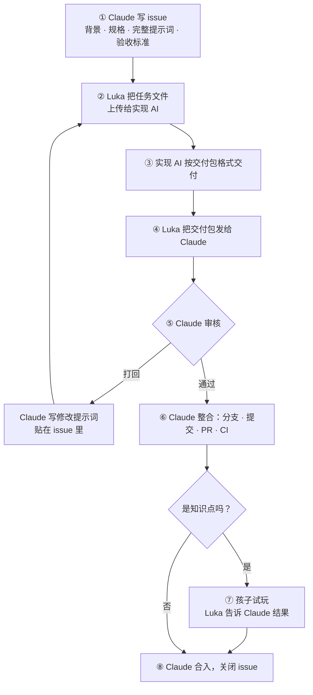

# 协作工作流

**Claude 是这个仓库唯一的维护者。**其他 AI 只负责实现，碰不到 git：Luka 把 Claude 写好的提示词交给它们，再把交付物带回来给 Claude。审核、整合、提交、合入，全部由 Claude 完成。

这样做的好处：

- 只有一个人在写 git，不会冲突，也不会出现几个 AI 互相覆盖的情况；
- 每一次进仓库的改动都经过同一套审核；
- 实现交给最擅长这件事的模型，换模型不影响仓库。

## 三个角色

| 角色 | 做什么 | 不做什么 |
| --- | --- | --- |
| **Claude**（维护者） | 写 issue、提示词和规格；审核交付物；整合进仓库；提交、开 PR、合入；维护文档和 CI | 不审自己写的架构改动（见「Claude 自己的改动」） |
| **实现 AI**（任何模型） | 读提示词，按「交付包」格式交付 | 不碰仓库，不改规格；规格有疑问就写进交付包的「疑问」一节 |
| **Luka** | 在 Claude 和实现 AI 之间传话；孩子试玩；拍板 | 不写代码，不用操作 git |

## 一件事的完整流程



1. **Claude 写 issue。**按 `.github/ISSUE_TEMPLATE/task.md` 的结构写，里面的提示词必须**自成一体**：实现 AI 看不到仓库，所以需要的规格、契约、风格要求、交付格式，全部写进提示词里。同一份提示词同时存为 `prompts/<任务 id>.md`。
   - 提示词开头写明「基于提交 `<提交号>`」。贴进提示词的规格只是那个提交时的快照，**仓库里的文件才是唯一原件**。规格改了以后，旧提示词不能直接再用，要重新生成。
2. **Luka 派发。**Claude 在对话里发给 Luka 一个任务文件 `<任务 id>.task.md`（就是完整的提示词）。任务文件由 `tools/make_task.py` 从 `prompts/<任务 id>.md` 生成：规格、契约、交付包格式都从**已合入 `main` 的那个提交**里原样嵌入，文件末尾列出每个嵌入文件的 SHA-256，同时给出收货时要用的 `--expect-*` 参数。Luka 把它原样上传给选定的实现 AI。issue 里会写「建议用哪个模型」，Luka 也可以自己选。同一个文件也提交在任务的工作分支上，issue 里有链接，作为留档。
3. **实现 AI 交付。**按 `docs/submission.md` 的「交付包」格式输出。文件太长时，可以单独存成文件，文件名必须和交付包里的清单一致。
4. **Luka 带回。**在和 Claude 的对话里发一句「交付 #<issue 号>」，附上交付包（粘贴或附件都行）。
5. **Claude 收货、审核。**先用 `tools/intake.py` 收货，并用 `--expect-issue`、`--expect-task`、`--expect-commit`、`--expect-version` 对照任务文件里的期望值：检查分段、清单、截断，确认交付基于正确的任务和提交，并算出每个文件的字节数和 SHA-256。再按下面的审核清单逐条检查。
   - **通过**：进入第 6 步。
   - **打回**：Claude 在 issue 里贴一段「修改提示词」，说清楚哪里不对、要怎么改。Luka 把它发给**同一个**实现 AI（保留它的上下文），回到第 3 步。
   - 打回两轮还不过：问题多半在提示词。Claude 重写提示词，或者建议换一个模型。
6. **Claude 整合。**开分支，把文件放到规定的位置，补上提示词文件，提交（带署名），开 PR，等 CI 绿勾。
7. **孩子试玩**（只有知识点任务才有这一步）。Claude 给 Luka 一个可以直接打开的预览。孩子玩完，Luka 在对话里告诉 Claude 三件事：先猜再看了吗、问「为什么」了吗、能独立玩完吗。Claude 把这三条写进 PR。
8. **Claude 合入**（squash 合并），关闭 issue。

## issue 怎么分

- **知识点**：一个知识点一个**主 issue**（标签 `知识点`），对应一个 PR，分支 `kp/<知识点 id>`。知识点卡由 Claude 自己写，记在主 issue 里。
- **活动**：知识点下的每个活动一个**子 issue**，提示词、交付、审核记录都在子 issue 里。主 issue 用勾选框列出全部子 issue（`- [ ] #13`），全部完成后才能开始试玩。
- **其他事**（架构、平台功能、修复、杂项）：一件事一个 issue，对应一个 PR。

状态标签贴在**实际流转的那个 issue** 上：活动的状态贴在子 issue 上，知识点主 issue 只用 `待试玩`。

## issue 状态

用标签表示 issue 走到了哪一步，由 Claude 维护：

| 标签 | 意思 | 下一步谁动 |
| --- | --- | --- |
| `待派发` | 提示词写好了 | Luka 交给实现 AI |
| `待审核` | 交付包已经带回 | Claude 审核 |
| `打回` | 修改提示词已贴在 issue 里 | Luka 发给同一个实现 AI |
| `待试玩` | PR 已就绪，等孩子试玩 | Luka |
| （关闭） | 已合入 | — |

另外有两个类别标签：`知识点`、`架构`。

想知道还有哪些事等着自己，Luka 只要在 Issues 页面按 `待派发`、`打回`、`待试玩` 三个标签筛选就行。

## 审核清单

Claude 收到交付包后逐条检查，结果作为一条评论写进 issue：

1. **完整**：`tools/intake.py` 收货通过（分段齐全、文件和清单一致、没有截断）。
2. **规格**：通过 `tools/ci_checks.py`（schema、ID、文案、图谱）。
3. **契约**：只用 `docs/activity-contract.md` 里规定的消息；不联网，不读写存储，不依赖外部 CDN。
4. **验收标准**：issue 里的每一条都满足。
5. **内容**：科学上准确；适合孩子的年龄；句子短，不出现「学习」二字；每个误区都有题目或实验步骤针对。
6. **风格**：手绘风；深色、浅色两种模式都能看清；只用触摸也能操作完。
7. **疑问**：交付包里「疑问」一节提到的每个问题，都要有答复或处理。

审核评论的格式：

```
审核 · 第 N 轮 · 实现者：<模型名> · 基于提交 <提交号>
结果：通过 / 打回
收货：<tools/intake.py 的报告：每个文件的路径、字节数、SHA-256 前 16 位>
问题：
1. …
```

收货报告里的哈希，就是这一轮交付的指纹。整合进仓库时，Claude 核对提交里的文件和通过审核的那一轮哈希一致。

## 整合到仓库

- **分支名**按改动类型：`kp/<知识点 id>`、`arch/…`、`feat/…`、`fix/…`、`chore/…`。知识点改版也用 `kp/<知识点 id>`，不加 `-v2` 之类的后缀（上一个分支合入后已删除，名字可以重用）。CI 的「地盘检查」照样生效，防止 Claude 整合时手滑改到范围外的文件。
- **提交署名**：

  ```
  Implemented-By: <实现模型名>
  Reviewed-By: Claude
  Refs: #<issue 号>
  ```

- **PR** 用仓库的 PR 模板，写明实现者、审核了几轮、怎么验收。
- **越界**：必须改地盘以外的文件时，Claude 先在对话里问 Luka。Luka 同意后，Claude 给 PR 加上 `越界-已批准` 标签，并在 PR 评论里注明「Luka 于某日在对话中同意」。

## Claude 自己的改动

架构、规格、CI 这类改动由 Claude 亲自写，不能自己审自己。做法是同一套流程反过来走一遍：

1. Claude 开 `arch/…` PR，并写一份「审阅提示词」。
2. Luka 把它交给另一个模型（或者一个新开的、没参与过的 Claude 会话）。
3. Luka 把审阅意见带回来，Claude 逐条回应、修改，然后合入。改动大、或者有新设计时，再请审阅一轮。
4. 审阅意见原文和 Claude 的回应存档在 `docs/reviews/pr-<PR 号>.md`，同时贴在 PR 评论里。
5. 合入规格改动之前，逐节对照规格开头「依据」里列出的每份文档（ADR、领域模型、契约），确认没有互相矛盾的地方。规格修订了哪份文档，就在同一个 PR 里改掉那份文档。

小的文档修正（错别字、链接）可以跳过审阅，直接合入。

## 必须先问 Luka 的事

- 删除文件、强制推送、改写提交历史；
- 修改已经发布的 ID；
- 涉及孩子数据的迁移；
- 规格有歧义，或者两条规则互相矛盾；
- 合入任何没有通过 CI 的 PR。

## CI 检查什么

每个 PR 都会自动跑「检查」：

| 检查项 | 内容 |
| --- | --- |
| 检查脚本自测 | `tools/tests/` 里的正反测试全部通过，确保检查本身没坏 |
| 地盘检查 | 改动的文件都在这个分支类型允许的范围内。`kp/` 分支只能改这个知识点的卡片，以及 `targets` **只有**这个知识点的活动和它们的提示词 |
| 规格校验 | schema 合法；知识点卡和活动 manifest 通过校验；文件名和 id 一致；没有重复 ID；前置引用都存在且不成环 |
| 引用 | 知识点的 `activities` 和活动的 `targets` 双向一致；活动针对的误区出自目标知识点 |
| 发布门禁 | `published` 的知识点：所有活动都是 `approved`；至少有一个 `explain` 和一个 `quiz`；每个误区都有活动针对 |
| ID 检查 | 没有删除、改名或改动已有的 ID（解析 YAML 后比较，只改写法、比如加引号，不算改动） |
| 文案检查 | 给孩子看的文字里不出现「学习」 |
| 署名提醒 | 提交里是否写了 `Implemented-By:`、`Agent:` 或 `Co-Authored-By:`；只提醒，不拦截 |

两点说明：

- **共享活动**：一个活动同时针对几个知识点时，改它会影响所有这些知识点。`kp/` 分支只能改「只针对这一个知识点」的活动；共享活动要单独开 PR，覆盖所有受影响知识点的审核和试玩，并在征得 Luka 同意后加 `越界-已批准` 标签。CI 会列出受影响的知识点。
- **过渡期发布不了任何知识点**：CURIO-002a 之后，自定义活动的 `type` 只能是 `experiment` 或 `simulation`，讲解和挑战改为结构化活动；而 CI 要到 CURIO-002b 才认得结构化活动。所以这段时间里，发布门禁「至少有一个 explain 和一个 quiz」任何知识点都满足不了。这是有意的：还没有真实内容，宁可暂时谁都发布不了，也不放松门禁。CURIO-002b 合入时恢复正例测试。
- **误区覆盖是过渡检查**：现在只看活动 manifest 里声明的 `misconceptions`，证明不了具体题目真的针对了这个误区。ADR-002 的结构化题目落地后（CURIO-002），覆盖关系改为从题目和选项数据计算，manifest 里的声明不再作为依据。

契约测试台、断网运行检查、平板截图在 P1 阶段加入。

## 一次性设置（Luka 在 GitHub 网页上做，2026-11-06 已完成）

**规则集**：Settings → Rulesets → New branch ruleset。现有的规则集叫「Protect Main」，内容如下：

| 项目 | 设置 | 原因 |
| --- | --- | --- |
| Enforcement status | Active | 不改成 Active，规则不生效 |
| Bypass list | 空 | 谁都绕不过，包括 Luka 的账号（也就是 Claude 在用的账号） |
| Target branches | Include default branch（`main`） | |
| Restrict deletions、Block force pushes | 勾选 | `main` 不能被删除，历史不能被改写 |
| Require a pull request before merging | 勾选；Required approvals 为 **0**；Allowed merge methods 只留 **Squash** | 所有提交都来自同一个账号，GitHub 不允许自己批准自己，审批数设成 1 就什么都合不进去 |
| 同上，additional settings 里关于 **unattributed changes** 的那一项 | **不勾** | 这是 GitHub 还在预览中的功能，规则集接口里默认开启。开着的话，由应用开出的 PR（Claude 开的就是）即使审批数为 0，也要等真人批准，而 Luka 批准不了自己账号下的 PR |
| Require status checks to pass | 勾选；Require branches to be up to date 勾选；只保留 `检查`（来源 **GitHub Actions**） | 来源设为 Any source 的话，任何应用都能报告「检查通过」，等于开了后门 |
| Require linear history | 勾选 | 和只允许 Squash 配套 |

**自动删除分支**：Settings → General → Pull Requests，勾选 **Automatically delete head branches**。Claude 这边删不了远程分支，不勾的话，合入过的 `kp/<知识点 id>` 分支会一直留着，改版时就没法重用这个名字。

**检查设置有没有被改动**：Claude 可以随时读出规则集的实际配置（`gh api repos/deepnorth2077/curio/rulesets`），和上表对照。

设好之后，Claude 也必须走 PR，并且只有 CI 通过才能合入。
