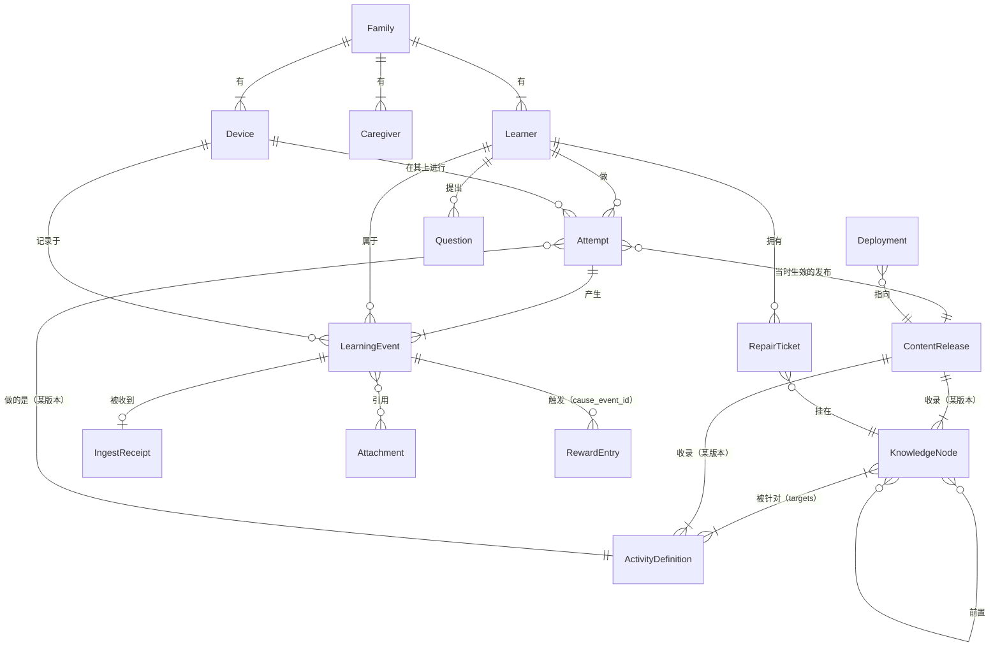

# 领域模型

> 状态：**已接受**（2026-11-06，经外部模型复审修订；CURIO-001）。相关决策见 `docs/adr/`。

这里定义 Curio 平台内核里的对象：它们是什么、谁拥有、怎么变化、版本边界在哪里。界面怎么呈现这些对象（星图、地铁、维修舱、主题），不在这份文档的范围内。

## 对象一览

| 对象 | 是什么 | ID | 谁拥有 | 生命周期 | 版本边界 |
| --- | --- | --- | --- | --- | --- |
| **Family** 家庭 | 数据的边界。一套 Curio 只服务一个家庭 | `fam_<ULID>` | 系统 | 安装时创建 | 无 |
| **Learner** 学习者 | 一个孩子 | `lrn_<ULID>` | Family | 在用 → 归档（不删除） | 档案字段可改，ID 不变 |
| **Caregiver** 家长 | 能看进度、设奖励、确认兑换的大人 | `cg_<ULID>` | Family | 在用 → 停用 | 无 |
| **Device** 设备 | 一个浏览器上的一份安装。产生事件，参与同步 | `dev_<ULID>` | Family | 配对 → 在用 → 注销 | 自带递增序号 `device_seq` |
| **KnowledgeNode** 知识点 | 要懂的一件事，例如「分数的初步认识」 | `math.number.fraction-intro` | 内容仓库 | 草稿 → 已审 → 已发布 → 弃用（不删除） | `version` 整数，改内容就加一 |
| **ActivityDefinition** 活动定义 | 围绕知识点的一个讲解、挑战、实验，可以反复做 | `act.quiz.fraction-intro-01` | 内容仓库 | 待审 → Claude 已审 → 已批准 → 弃用 | `version` 整数 |
| **ContentRelease** 内容发布 | 一组已发布内容的不可变清单：收录哪些知识点、活动的哪个版本，每个文件的哈希 | `rel_<完整内容哈希>`；界面上显示 `<日期> · <前 8 位>` | 构建管线 | 没有状态，生成后不再变化 | 本身不可变。相同内容永远得到同一个 ID |
| **Deployment** 部署 | 「当前生效的是哪个发布」这个指针，以及它的变更历史 | `dep_<ULID>` | 构建管线 / 家长 | 预览 → 生效 → 被取代 / 回滚 | 每次切换记一条，指针可变，发布本身不变 |
| **Attempt** 尝试 | 某个孩子在某台设备上，把某个活动从头做一遍 | `att_<ULID>` | Learner | 开始 → 完成 / 放弃 | 固定引用一个 ContentRelease 和活动版本 |
| **LearningEvent** 学习事件 | 一件已经发生的事实，例如「预测选了 B」「答错第 3 题」 | `evt_<ULID>`；另外 `(device_id, device_seq)` 也唯一 | Learner | 只追加，不修改。例外只有附件擦除、私人文字删除和撤销错误导入，见 ADR-004 | 带 `schema` 版本，旧事件靠升级器读取。不含自由文字 |
| **PrivateText** 私人文字 | 孩子或家长写的一段自由文字：反思、提问、备注 | `txt_<ULID>` | Learner | 写入 → 可被删除 | 内容不可改；被事件引用；删除后事件保留，只是看不到文字。详见 `docs/specs/events.md` 第 4 节 |
| **IngestReceipt** 摄入收据 | 服务器收到一条事件的记录：`recorded_at`、来自哪次同步、有没有时钟偏差 | 以 `event_id` 为键 | 家用后端 | 收到时写一次 | 和事件分开存，不改动设备产生的事件 |
| **Attachment** 附件 | 错题裁剪图、语音等二进制内容，被事件引用 | `blob_<SHA-256>`（按内容寻址，相同内容只存一份） | Learner | 存入 → 可被加密擦除 | 内容不可变 |
| **Question** 问题 | 信号站里孩子提的一个「为什么」 | `q_<ULID>` | Learner | 提出 → 已回答 → 已归档 | 状态变化都记成事件 |
| **RepairTicket** 错题 | 维修舱里的一道题 | `rep_<ULID>` | Learner | 待修 → 复练中 → 已修好 | 状态变化都记成事件 |
| **Plan** 航线 | 某一天选的 2 个主线和 1 个自由探索 | `plan_<ULID>`；`learner_id` 和 `plan_date` 是字段，`(learner_id, plan_date)` 唯一 | Learner | 规划 → 进行中 → 结束 / 被取代 | 状态变化都记成事件。两台设备离线时同一天各建了一个，按 ADR-004 的确定性排序保留第一个，另一个记为「被取代」 |
| **RewardEntry** 奖励流水 | 一笔能量或补给点的变动：获得、花费、调整、撤销 | `rwd_<由唯一键算出的哈希>` | Learner | 从事件算出，随时可重建 | 带 `cause_key`、`cause_event_id`、`rule_id`、`rule_version`，`(learner_id, cause_key, rule_id, currency)` 唯一。详见 ADR-004 和 `docs/specs/events.md` |
| **Projection** 投影 | 从事件算出来的状态：掌握度、点亮、复习计划 | 无，随时可重算 | 系统 | 随时重算 | 带 `algorithm_version` |

ID 的规则：

- **运行时对象一律用 ULID**：设备离线时自己就能生成，不会和别的设备撞号，而且按时间排序。业务上的唯一性（例如「每个孩子每天只有一条航线」）用唯一约束表达，不塞进 ID。
- **内容对象**用人能读懂的点分路径，一旦发布就永不改动。
- **按内容寻址的对象**（内容发布、附件）用内容哈希作 ID，相同内容永远是同一个 ID。

## 四个容易混的概念

- **KnowledgeNode**：要懂的东西。它不知道孩子做过什么。
- **ActivityDefinition**：帮孩子弄懂这件事的一种方式。一个知识点通常有讲解、挑战，有时还有实验。它也不知道孩子做过什么。
- **Attempt**：孩子某一次做某个活动。同一个活动做三遍，就是三个 Attempt。Attempt 锁定当时的内容版本：内容后来改了，旧 Attempt 依然指向孩子当时看到的那一版。
- **LearningEvent**：Attempt 里（或者 Attempt 之外，例如提问、打卡）发生的一件具体的事。事件是唯一的事实来源；掌握度、点亮、奖励余额全部由事件算出来。

另外两对也容易混：

- **ContentRelease 和 Deployment**：发布是一份不可变的内容清单；部署只是「现在用哪一份」的指针。回滚改的是指针，发布本身从不改动。
- **LearningEvent 和 IngestReceipt**：事件是设备上发生的事，产生后就固定了；收据是服务器什么时候收到它。两者分开存，同步、重放都不会改动事件本身。

## 关系

## 单家庭，不等于省掉 ID

Curio 只服务一个家庭、目前只有一个孩子，但 `learner_id` 和 `device_id` 从第一天起就写进每一条事件。原因：

- 平板、电脑、手机三台设备要同步，没有 `device_id` 和 `device_seq`，就无法去重，也发现不了漏传。
- 以后多一个孩子，或者换一台设备，历史数据不用迁移。
- 补上这两个字段几乎没有成本；以后再补，就要改写全部历史事件。

## 平台内核和产品外壳

| 平台内核（长期稳定，改动要走 ADR） | Curio 产品外壳（可以替换，不影响数据） |
| --- | --- |
| 上表里的全部对象和它们的 ID | 星图、知识地铁、维修舱、信号站、航线这些叫法和界面 |
| 内容格式、发布格式、事件格式 | 手绘风格、配色、字体、宝可梦等主题 |
| 活动宿主和契约 | 每个具体的讲解、挑战、实验 |
| 存储、同步、导出、恢复 | 激励规则的参数（几点能量换什么） |
| 投影算法的接口 | 具体用哪个掌握度算法 |
| AI 网关的能力契约 | 具体接哪家模型 |

判断标准：**换掉它之后，孩子的历史数据还能不能原样读出来**。能，就属于外壳；不能，就属于内核。

## 非目标

下面这些不做。以后真需要，再单独开 ADR：

- 多租户：一套部署服务多个家庭；
- 公开账户体系、注册登录、第三方登录；
- 公开的插件市场，或者让外人上传活动；
- 复杂的权限体系（Caregiver 都是同等权限）；
- 黑盒的知识追踪模型；
- AI 自动出题后不经审核直接发布；
- 微服务、消息队列、分布式数据库。
